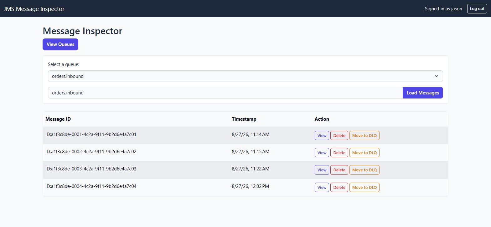
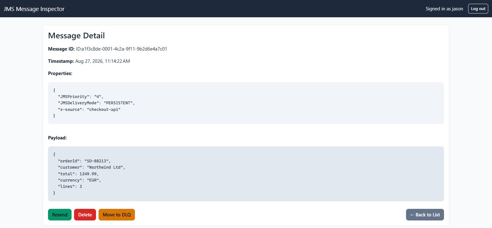
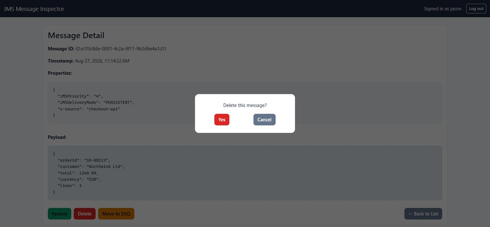
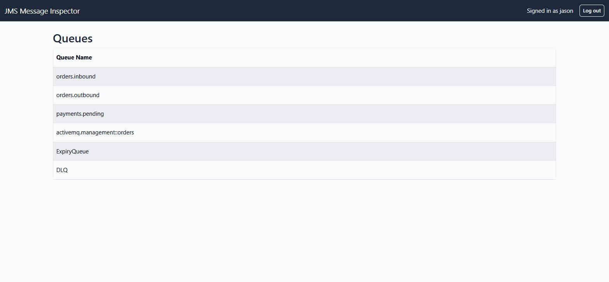
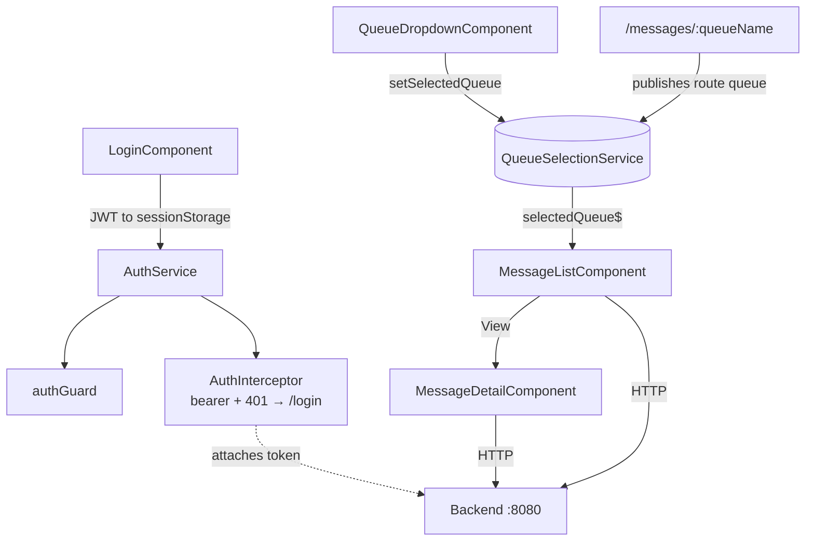

# Message Inspector — UI

[](https://github.com/Jason-McKay/message-inspector-ui/actions/workflows/ci.yml)

An Angular 22 front end for inspecting **ActiveMQ Artemis JMS queues**: pick a queue, browse
its messages, view one (with pretty-printed JSON/XML payloads), and resend / delete / move
it to a dead-letter queue. It talks to the
[Spring Boot backend](https://github.com/Jason-McKay/message-inspector) on `:8080`.

## Screenshots

| Message list | Message detail (pretty-printed payload) |
|---|---|
|  |  |

| Confirm a destructive action | Queue diagnostics |
|---|---|
|  |  |

Sign-in ([screenshot](docs/images/login.jpg)) gates the whole app behind a route guard.

## How it fits together

An **NgModule** app (not standalone components) — everything is declared in `app.module.ts`.
The one piece of cross-component wiring worth knowing is `QueueSelectionService`: it is the
single source of truth for "which queue am I looking at". The dropdown writes to it; the
message list subscribes and refetches on every change.



## Running it

Needs the **backend running on `:8080`** (see its repo) and **Node 24** — `.nvmrc` pins
24.18.0, and Angular 22 accepts `^22.22.3 || ^24.15 || >=26`:

```bash
nvm use 24.18.0     # nvm install 24.18.0 first if needed
npm install
npm start           # ng serve on http://localhost:4200
```

No backend to hand? `npm run mock` serves a stand-in on `:8080` with a control panel for
forcing each failure mode — see [`mock-server/README.md`](mock-server/README.md).

Log in with `jason`/`jason` (USER) or `admin`/`admin` (ADMIN — the only role that can delete
or move to DLQ).

## Testing

```bash
npx ng test --watch=false --browsers=ChromeHeadless
npm run lint        # angular-eslint, src/**/*.ts and src/**/*.html
```

The suite is behavioural, not smoke-only: it runs against jasmine-spied services (not
`HttpClientTestingModule`), so each component is covered for success, body-level failure,
and HTTP-level failure. Destructive actions carry template-level specs that click the
rendered button — a regression guard, because the bug they prevent (wiring a button straight
to the service, bypassing the confirm modal) passes a spec that calls the handler directly.

Lint is angular-eslint's recommended set with three rules turned off, each commented with
why in [`eslint.config.js`](eslint.config.js): standalone components, OnPush and `inject()`
would each be a refactor of the house style, not a lint fix.

Both commands run on every push/PR in CI
([`.github/workflows/ci.yml`](.github/workflows/ci.yml)), lint first, on **Node 24.18.0**
(pinned in `.nvmrc`) followed by a production `npm run build`.

## Patterns worth knowing before you touch a service call

- **The backend returns HTTP 200 on business failure**, with the outcome in the body as
  `{"success": false, "message": "..."}`. An Observable `next` does **not** mean the call
  worked — every caller checks `res.success`. Transport faults are separate: **400**
  rejected id, **502** broker down, **500** otherwise. `ToastService.apiError` /
  `describeApiError` is the single place these become user-facing text.
- **Every service URL is absolute to `:8080`.** There is no `proxy.conf.json`; a relative
  URL silently resolves against the dev server on `:4200`.
- **Route params pass through `Router.navigate` raw** — one encode per boundary (Router
  encodes, `ActivatedRoute` decodes, the service encodes for the HTTP call). Pre-encoding
  produces `%253A`, which the backend's servlet container rejects with a 400.

More detail — the gotchas, the response contract, and why several things are the way they
are — is in [`CLAUDE.md`](CLAUDE.md) and the backend's
[Architecture Decision Records](https://github.com/Jason-McKay/message-inspector/tree/master/docs/adr).
